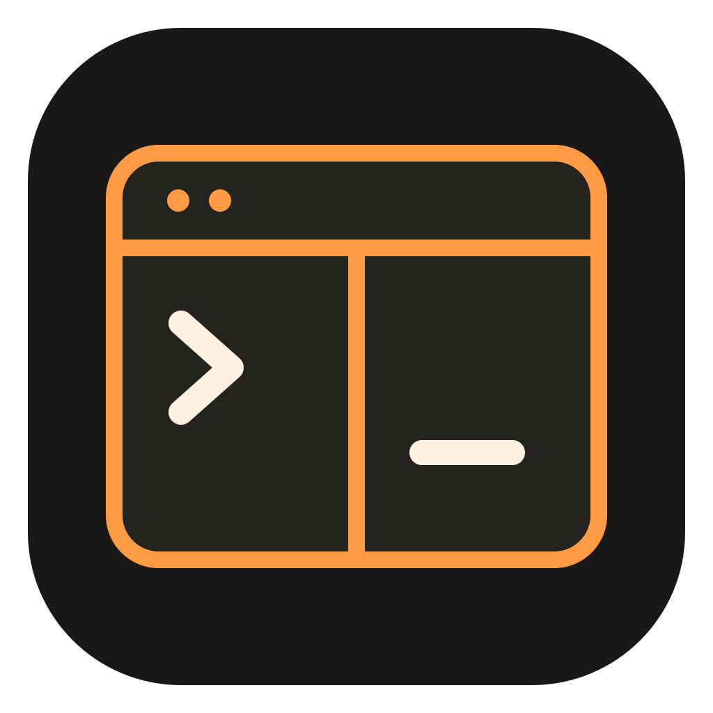
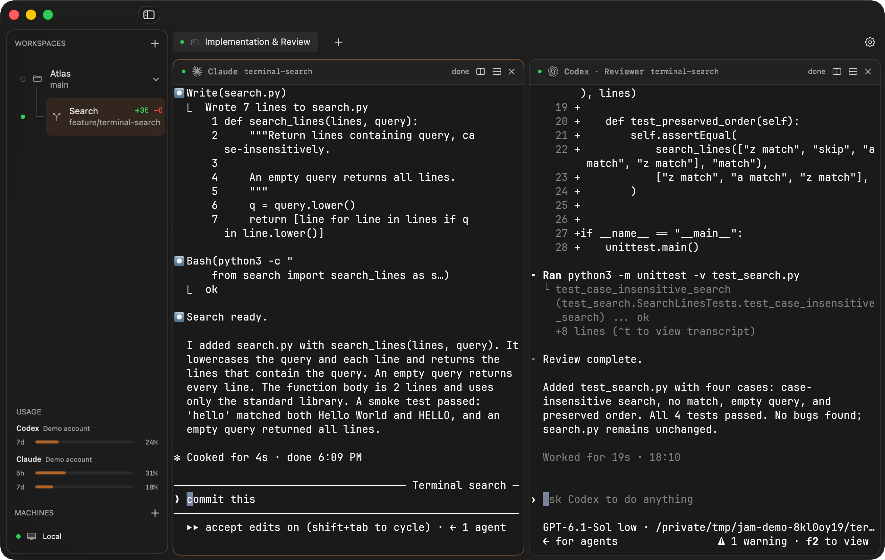

<p align="center"></p>
<h1 align="center">Jam</h1>
<p align="center">A native macOS terminal for working with AI agents across projects and machines.</p>



<sub>Claude implements terminal search while Codex reviews it and runs the tests. Quota values use sample data. Regenerate with `python3 docs/images/capture.py`.</sub>

Jam keeps terminals, Git worktrees, and agent conversations together. Work locally or connect to a Linux machine over SSH. Give a workspace coordinator a task, follow its workers, and keep the terminals within reach.

- Native macOS interface with GPU-rendered terminals, tabs, and split panes.
- Workspaces and worktrees with Git summaries and individual activity indicators.
- Claude and Codex integrations, usage reporting, and workspace or worktree coordinators.
- Durable task assignments and agent inboxes, with saved conversation recovery.
- Remote terminals backed by a user-owned Linux daemon.

## Install

Initial releases target **Apple Silicon Macs with macOS 14 or later**. Remote binaries target Debian 12 or a compatible Linux system with glibc 2.36+, on x86_64 or aarch64. SSH, Python 3, and systemd user services are required.

Download the app from [GitHub Releases](https://github.com/saffronjam/jam/releases), unzip it, and place `Jam.app` in `~/Applications`. Initial builds are ad-hoc signed, not Apple-notarized. macOS may require explicitly approving the downloaded app in **System Settings → Privacy & Security**.

Install the CLI with `~/Applications/Jam.app/Contents/Resources/bin/jam install-cli`, then ensure `~/.local/bin` is on your PATH.

## Upgrades

The app checks for updates automatically and offers **Upgrade…** or **Skip This Version**. Use **Jam → Check for Updates…** to check manually, or turn automatic checks off in **Settings → General**.

Run `jam upgrade` to check, download, and apply the latest stable release. Jam asks before interrupting active sessions. `jam update` is an alias; `jam upgrade --check --json` is available for scripts. See [upgrade behavior](docs/upgrading.md).

## Agents

Install and sign in to Claude Code or Codex separately. Jam detects integrations on each machine; enable the ones you want in Settings. Ordinary terminal commands remain available regardless of integration settings.

Right-click a workspace or worktree to add a coordinator. Coordinators have a dedicated sidebar entry and can delegate work into separate worktrees. New features use a worktree unless you explicitly request the existing checkout. Publishing, pushing, and merging follow your instructions.

Read [coordinator behavior](docs/coordinators.md) for roles, instructions, task delivery, and recovery. Agent usage may require granting Jam access to the provider's credentials in Keychain.

## Remote machines

Add a machine through the sidebar. Jam uses SSH and installs a server under your Linux user account. No root daemon is required. Session persistence between logins depends on systemd lingering; Jam explains when it needs enabling.

Saved layouts and agent conversations can be restored after a server restart. Ordinary running shell processes do not survive that restart. See [remote workspaces](docs/remote-workspaces.md).

## Build

Install Python 3.11 or later, Xcode Command Line Tools, Rust through rustup, and [just](https://github.com/casey/just). The repository pins Rust and downloads a checksum-verified Zig toolchain into `.cache`.

```sh
just dev           # Build and launch the macOS app
just test core     # Rust, Swift logic, installer and snapshot checks
just check         # Full local checks, including native UI tests
just remote-build  # Build both Linux server architectures using Docker
just bundle        # Package the app with its remote servers
```

Developer binaries and caches stay inside the checkout. Release builds must include both Linux server archives and all dependency notices.

## Architecture

A Rust daemon owns terminal sessions. A shared renderer draws terminal contents; Swift provides the macOS interface. The CLI and app use the same daemon protocol.

[Architecture](docs/architecture.md) · [Protocol](docs/protocol.md) · [Dependency licenses](docs/dependencies.md)

## License

Jam's original code and artwork are [MIT licensed](LICENSE). Bundled components retain their own licenses. Claude, Codex, and other third-party names and marks belong to their respective owners.
