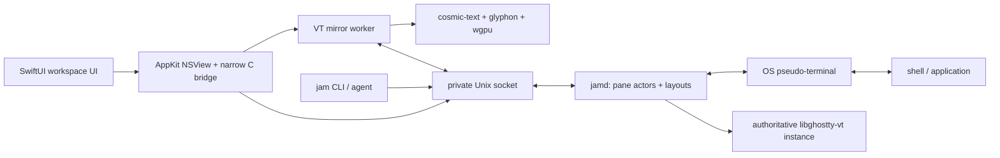

# Architecture

The daemon supervises PTYs and stores the workspace → tab → split tree → pane model. Each pane actor serializes terminal output, size changes, snapshots, and requests. A bounded PTY reader queue limits memory. A separate bounded writer prevents a paste into a blocked program from blocking terminal emulation. Exited children are reaped.

A GUI mirror receives a snapshot and numbered byte/geometry events. It owns its terminal instance on a worker thread; only owned cell frames cross into the main thread. This avoids sharing unsafe terminal pointers across threads. The renderer caches shaped rows and glyph rasters. Native UI owns windows, shadows, sidebars, focus, clipboard, and IME; the Rust renderer draws terminal cells and glyphs using Metal on macOS or Vulkan/OpenGL on Linux.

Snapshots are tied to the exact engine/protocol build. We reject incompatible handshakes instead of promising that cell screenshots can restore parser state. Sequence gaps close the mirror stream and request a fresh snapshot. Client mirrors never have a PTY-write callback. Query replies originate only from the authoritative instance.

Each pane’s last focused GUI owns its terminal size; other clients mirror that grid. CLI clients can capture, split, and send input concurrently. Unix filesystem permissions and peer UID checks restrict the daemon to its user. An agent running as that user has the same control authority as the CLI; pane IDs are not capability tokens. Sharing and finer agent capability boundaries require a separate design before remote access is exposed.

Quitting the UI leaves the daemon and children running. Restarting the daemon preserves only layout and metadata, with stopped panes. Jam does not restore running processes or silently relaunch old commands. Live mirrors and scrollback survive client reconnection only while the daemon survives.

SSH forwarding is an endpoint transport; GTK remains a future client, not dependencies of local process ownership. Their implementation must preserve ordered geometry/output, snapshot compatibility, bounded queues, and the sole query responder rule.

## Worktree workspaces and local commands

Workspace model 1 distinguishes persistent checkout ownership from live directory context. Each opened checkout owns independent tabs and PTYs and records its parent workspace. The sidebar groups that workspace’s checkouts by their pinned Git identity, even when its focused shell visits another repository. A background daemon worker supplies cached live Git context without changing membership. See [ADR 7](adr/0007-workspace-owned-checkouts.md). Git operations run on a serialized worker outside the terminal/state locks and expose pollable operation IDs. Closing a workspace affects sessions; deleting a checkout is separate and never deletes its branch. Failed deletion retains its stopped workspace for recovery.

The macOS command registry is shared by the palette and keyboard dispatcher. Shortcuts are configurable through a native editor backed by TOML; config changes reload without restarting terminals. The rendering clock follows the view's display, mirror frames are shared immutably, and a latest-value resize queue avoids blocking output on intermediate resize requests. These changes remove the former 30 Hz cap; exact performance parity with Ghostty is not assumed without comparative profiling.

See [remote workspaces](remote-workspaces.md) for setup, compatibility, and lifecycle.
